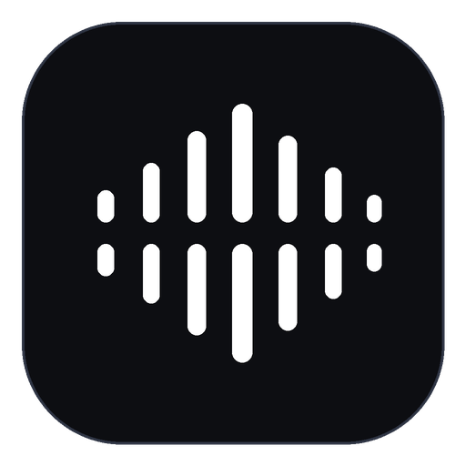
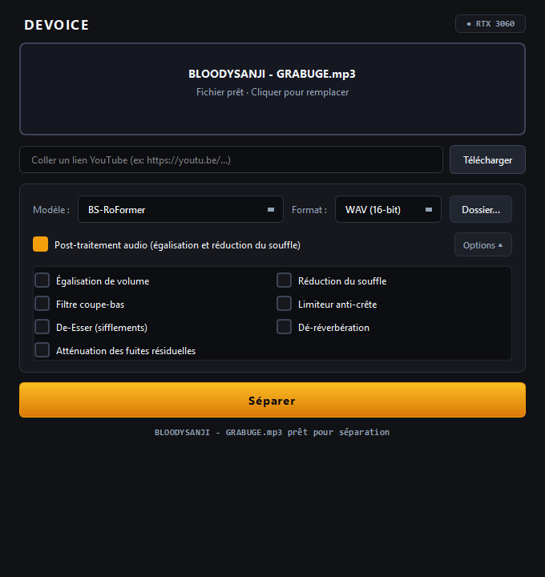

<div align="center">



```ascii
 ██████╗ ███████╗██╗   ██╗ ██████╗ ██╗ ██████╗███████╗
 ██╔══██╗██╔════╝██║   ██║██╔═══██╗██║██╔════╝██╔════╝
 ██║  ██║█████╗  ██║   ██║██║   ██║██║██║     █████╗  
 ██║  ██║██╔══╝  ╚██╗ ██╔╝██║   ██║██║██║     ██╔══╝  
 ██████╔╝███████╗ ╚████╔╝ ╚██████╔╝██║╚██████╗███████╗
 ╚═════╝ ╚══════╝  ╚═══╝   ╚═════╝ ╚═╝ ╚═════╝╚══════╝
```

### Studio-Grade Neural Vocal & Stem Separation Workstation

[](https://github.com/Req1quor/Devoice/releases/latest)
[](https://github.com/Req1quor/Devoice/releases/latest)
[](https://developer.nvidia.com/cuda-toolkit)
[](https://github.com/Req1quor/Devoice)
[](LICENSE)

<br/>

[**Download Devoice Setup (v2.0.0)**](https://github.com/Req1quor/Devoice/releases/latest) • [**Features**](#-features) • [**Audio Benchmark**](#-audio-benchmark) • [**DSP Processing Rack**](#-built-in-dsp-audio-processing) • [**DAW Workflow**](#-fl-studio--daw-integration)

<br/>


</div>

---

## ⚡ What is Devoice?

**Devoice** is an open-source, desktop neural audio workstation that isolates vocals, instrumentals, and stems locally with zero latency, zero cloud upload, and uncompromising 32-bit floating-point audio fidelity.

Equipped with **BS-RoFormer** and **MDX-Net** architectures running on **NVIDIA CUDA 12.1**, Devoice delivers world-class Signal-to-Distortion ratios (up to **12.98 dB SDR**) while packing an integrated **real-time DSP rack** (de-esser, vocal rider, noise purifier, room de-reverb, and true-peak limiter) directly into an ultra-clean, minimalist studio interface.

---

## ✨ Features

- 🧠 **SOTA Neural Separation Engines** — Powered by **BS-RoFormer** (ViperX) and **MDX-Net** (MDX23C).
- ⚡ **100% Offline & Private** — Runs entirely on your local GPU or CPU. No audio data ever leaves your PC.
- 🎛️ **Live DSP Post-Processing Rack** — Fine-tune de-esser, silence purifier, vocal rider, and de-reverb in real time without re-running the AI model.
- 📥 **Instant YouTube Ingestion** — Paste or drag-and-drop any YouTube link to fetch and isolate vocals in one fluid step.
- 🔊 **Lossless 32-Bit Float Engine** — Full dynamic range preservation to eliminate inter-sample clipping and phase artifacts.
- 🎹 **FL Studio One-Click Integration** — Seamlessly accessible as an external tool inside FL Studio's `Tools` menu.
- 🖤 **Dark Glass Minimalist UI** — Built for music producers, beatmakers, mixing engineers, and DJs.

---

## 📸 Interface Showcase

<div align="center">

| Real-Time Waveform & Playback | Built-in DSP Audio Rack |
| :---: | :---: |
|  |  |

</div>

---

## 📊 Audio Benchmark

Signal-to-Distortion Ratio (SDR) evaluated on standardized vocal benchmark testbeds:

| Model Architecture | Vocal SDR (dB) | Artifact Cleanliness | Typical Speed (RTX 3060) |
| :--- | :---: | :---: | :---: |
| 🥇 **BS-RoFormer (ViperX)** | **12.98 dB** | **Pristine** (Ultra-low bleed, studio ready) | ~15 - 20 s |
| 🥈 **MDX-Net (MDX23C)** | **10.87 dB** | **Sharp** (High transient retention) | ~8 - 12 s |
| 🥉 **Demucs v4 (HTDemucs)** | 9.20 dB | Moderate residual bleed | ~25 - 35 s |
| ⚠️ **Spleeter** | 6.30 dB | High phase smear, muffled top-end | ~5 s |

---

## 🎛️ Built-in DSP Audio Processing

Raw AI separation can leave behind subtle room reflections, microphone bleed, or harsh highs. Devoice features an integrated modular DSP chain:

```text
 ┌───────────────┐     ┌───────────────┐     ┌───────────────┐     ┌───────────────┐
 │ Vocal Rider   │ ──► │ De-Esser      │ ──► │ Noise Purifier│ ──► │ True-Peak     │
 │ (Auto-Gain)   │     │ (5k - 9kHz)   │     │ (Downward Exp)│     │ Limiter (-1dB)│
 └───────────────┘     └───────────────┘     └───────────────┘     └───────────────┘
```

* **Vocal Rider (Auto-Leveler)** — Automatically evens out vocal dynamics across inconsistent mic takes without squashy compression.
* **Precision De-Esser** — Transparently ducks harsh sibilants and piercing "S/T/Ch" friction between 5 kHz and 9 kHz.
* **Silence Purifier** — Downward multiband expansion that silences background bleed and room hiss during pauses.
* **Acoustic De-Reverb** — Strips out muddy room decay and reverb tails from wet vocal tracks.
* **Sub-Bass Low-Cut** — Surgical steep high-pass filter eliminating sub-rumble below 80 Hz.
* **True-Peak Limiter** — Studio brickwall ceiling locked at `-1.0 dBFS` to ensure zero inter-sample distortion.

---

## 🎹 FL Studio / DAW Integration

Devoice integrates directly into your digital audio workstation workflow:

1. During installation, select **`[x] Intégrer Devoice au menu Outils de FL Studio`**.
2. Inside FL Studio, navigate to **`Tools ➔ Devoice`**.
3. Devoice launches instantly in a dedicated window, ready to process or export stems directly back to your project folder.

---

## 🚀 Getting Started

### 1. Windows Standalone Installer (Recommended)

1. Download **`Devoice-Setup.exe`** from the [**Latest Release**](https://github.com/Req1quor/Devoice/releases/latest).
2. Choose your preferred install location (supports custom drives such as `E:\` or `D:\` without filling up `C:`).
3. Launch Devoice from your Desktop or Start Menu — **all neural runtimes and CUDA libraries are included out-of-the-box**.

### 2. Run from Source (Developers)

```bash
# Clone the repository
git clone https://github.com/Req1quor/Devoice.git
cd Devoice

# Create virtual environment
python -m venv venv
venv\Scripts\activate

# Install dependencies
pip install -r requirements.txt

# Run the workstation
python main.py
```

---

## 🛠️ Tech Stack

<p align="left">
  
  
  
  
  
  
</p>

---

## 📄 License

Distributed under the **GNU General Public License v3.0**. See [`LICENSE`](LICENSE) for complete terms.

<div align="center">
  <sub>Crafted with passion for musicians, beatmakers, and audio engineers.</sub>
</div>
