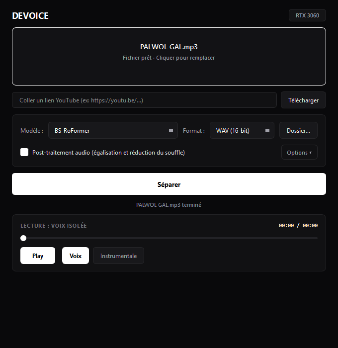

<div align="center">

# Devoice

Offline vocal & instrumental stem separation for desktop.

[](https://github.com/USERNAME/devoice/releases)
[](LICENSE)
[](https://github.com/USERNAME/devoice/releases)

<br/>



</div>

---

## What is Devoice?

Devoice is a desktop app for Windows that separates vocals and instrumentals locally on your machine.

Instead of uploading tracks to cloud services, it runs neural models directly on your GPU (or CPU) and includes built-in audio cleanup tools to handle bleed, volume drops, and harsh frequencies.

---

## Features

- **BS-RoFormer & MDX-Net engines** : Clean stem separation powered by the highest scoring open weights.
- **Live post-processing** : Adjust the de-esser, vocal rider, or noise gate *after* separation without having to re-run the AI model.
- **YouTube link support** : Paste a YouTube URL (or drag it from your browser) to download and load the track instantly.
- **32-bit float audio engine** : All audio processing is done in lossless float32 to prevent distortion and clipping before export.
- **100% offline & private** : Your files stay on your computer. No accounts, no subscriptions, no limits.
- **Clean dark UI** : Minimalist black & white interface designed to stay out of the way.

---

## Audio Benchmark

Signal-to-Distortion Ratio (SDR) measured on vocal test datasets:

| Model | Vocal SDR | Quality |
| :--- | :---: | :---: |
| **BS-RoFormer (ViperX)** | **12.98 dB** | Cleanest vocal isolation, minimal artifacts |
| MDX-Net (MDX23C) | 10.87 dB | Good separation, very fast |
| Demucs v4 (HTDemucs) | 9.20 dB | Standard baseline |
| Spleeter | 6.30 dB | Noticeable bleed and phase issues |

---

## Built-in Audio Processing

When isolating a vocal from a busy beat, raw separation can leave behind harsh frequencies, volume dips, or room reflections. Devoice lets you toggle these filters on or off at any time:

- **Volume leveler** : Keeps the vocal gain consistent throughout the track, especially on loud productions where the voice drops in volume.
- **De-esser** : Tames harsh sibilance ("S" sounds) between 5 kHz and 9 kHz without muffling the rest of the voice.
- **Silence purifier** : A soft downward expander that removes residual beat bleed and hiss during vocal pauses.
- **De-reverb** : Dries up room echo on wet vocal recordings.
- **Low-cut filter** : Cuts sub-bass rumble below the fundamental frequency of the voice.
- **True-peak limiter** : Caps signal peaks at -1.0 dBFS to prevent inter-sample clipping on speakers and headphones.

---

## Getting Started

### Windows Installer (Easiest)

1. Download **`Devoice-Setup.exe`** from the [Releases](https://github.com/USERNAME/devoice/releases) page.
2. Run the installer and launch Devoice from your desktop.

### Run from Source

Requires Python 3.10+ and an NVIDIA GPU (recommended, CUDA 12.1):

```bash
# Clone the repository
git clone https://github.com/USERNAME/devoice.git
cd devoice

# Create virtual environment
python -m venv venv
venv\Scripts\activate

# Install dependencies
pip install -r requirements.txt

# Run the app
python main.py
```

---

## License

GNU General Public License v3.0 (GPLv3). See [LICENSE](LICENSE) for details.
