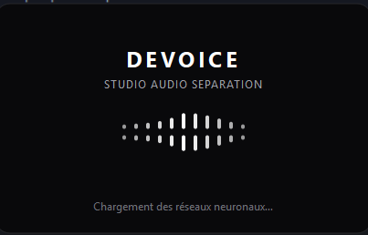
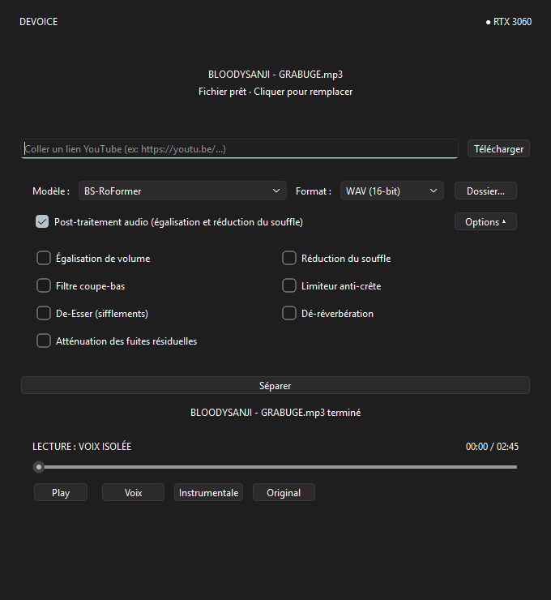
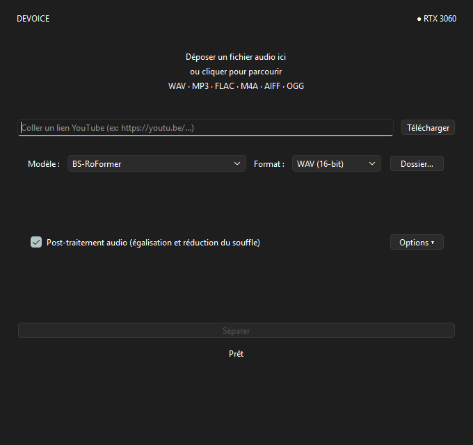

<div align="center">


<pre align="center">
               · · ·  |  ||  |||||  |||||||  |||||  ||  |  · · ·

  ██████╗  ███████╗ ██╗   ██╗  ██████╗  ██╗  ██████╗ ███████╗
  ██╔══██╗ ██╔════╝ ██║   ██║ ██╔═══██╗ ██║ ██╔════╝ ██╔════╝
  ██║  ██║ █████╗   ██║   ██║ ██║   ██║ ██║ ██║      █████╗  
  ██║  ██║ ██╔══╝   ╚██╗ ██╔╝ ██║   ██║ ██║ ██║      ██╔══╝  
  ██████╔╝ ███████╗  ╚████╔╝  ╚██████╔╝ ██║ ╚██████╗ ███████╗
  ╚═════╝  ╚══════╝   ╚═══╝    ╚═════╝  ╚═╝  ╚═════╝ ╚══════╝

             [ OFFLINE NEURAL STEM SEPARATION WORKSTATION ]
</pre>

<p align="center">
  <b>High-Fidelity Neural Stem Separation & Studio DSP Post-Processing Desktop Suite</b>
</p>

<p align="center">
  <a href="https://github.com/Req1quor/Devoice/releases/latest"></a>
  <a href="https://github.com/Req1quor/Devoice/releases/latest"></a>
  <a href="https://developer.nvidia.com/cuda-toolkit"></a>
  <a href="https://github.com/Req1quor/Devoice"></a>
  <a href="LICENSE"></a>
</p>

<p align="center">
  <a href="https://github.com/Req1quor/Devoice/releases/latest">Download Standalone Installer (v2.0.0)</a> &nbsp;|&nbsp;
  <a href="#overview">Overview</a> &nbsp;|&nbsp;
  <a href="#workstation-interface">Workstation Interface</a> &nbsp;|&nbsp;
  <a href="#audio-benchmark">Audio Benchmark</a> &nbsp;|&nbsp;
  <a href="#built-in-dsp-audio-rack">DSP Rack</a> &nbsp;|&nbsp;
  <a href="#fl-studio-integration">FL Studio Integration</a>
</p>

<br/>

<table align="center" border="0" cellpadding="8" cellspacing="0">
  <tr>
    <td align="center" valign="middle">
      <br/>
      <sub><b>Startup</b> &mdash; Hardware detection & neural weights verification</sub>
    </td>
    <td align="center" valign="middle">
      <br/>
      <sub><b>Active Session</b> &mdash; Neural separation, DSP drawer & waveform player</sub>
    </td>
  </tr>
</table>

</div>

---

## Overview

Devoice is a dedicated Windows desktop neural audio workstation engineered for high-fidelity vocal, instrumental, and stem isolation. Operating entirely offline on local hardware, it eliminates cloud latency, subscription fees, and audio compression.

Equipped with **BS-RoFormer** and **MDX-Net** architectures executed via **NVIDIA CUDA 12.1**, Devoice attains Signal-to-Distortion ratios of up to **12.98 dB SDR**. It incorporates an integrated **real-time DSP rack** (de-esser, silence purifier, vocal rider, room de-reverb, and true-peak limiter) directly into an uncluttered studio interface.

---

## Workstation Interface

<div align="center">

| Idle Workspace | Active Session & Audio Processing Rack |
| :---: | :---: |
|  |  |
| *Hardware-accelerated drag-and-drop & YouTube ingestion* | *Post-processing toggles, status feedback & stem preview* |

</div>

---

## Core Features

- **Neural Separation Architectures** &mdash; Implements BS-RoFormer (ViperX) and MDX-Net (MDX23C) for surgical vocal extraction.
- **Offline & Local Execution** &mdash; All computation occurs directly on local GPU or CPU. No audio telemetry or remote uploads.
- **Real-Time DSP Processing Chain** &mdash; Interactive adjustments for de-essing, volume leveling, silence gating, and room drying without re-running inference models.
- **Direct YouTube Ingestion** &mdash; Automatic downloading, conversion, and waveform loading from any standard YouTube URL.
- **Lossless 32-Bit Floating-Point Core** &mdash; Audio pipelines preserve full dynamic headroom to prevent internal truncation and phase distortion.
- **FL Studio Tool Integration** &mdash; Direct registration inside the FL Studio `Tools` menu for frictionless production workflows.
- **Non-C Drive Deployment** &mdash; Install and cache large neural models across dedicated audio storage drives (e.g. `E:\`, `D:\`).

---

## Audio Benchmark

Signal-to-Distortion Ratio (SDR) measured on standardized vocal test benchmarks:

| Model Architecture | Vocal SDR (dB) | Artifact Profile | Typical Duration (RTX 3060) |
| :--- | :---: | :--- | :---: |
| **BS-RoFormer (ViperX)** | **12.98 dB** | Minimal residual bleed, studio-grade top-end | 12 - 18 s |
| **MDX-Net (MDX23C)** | **10.87 dB** | Sharp transient preservation, high speech clarity | 8 - 12 s |
| **Demucs v4 (HTDemucs)** | 9.20 dB | Standard baseline, minor mid-band masking | 25 - 35 s |
| **Spleeter** | 6.30 dB | Audible phase smearing and spectral artifacts | 5 - 8 s |

---

## Built-in DSP Audio Rack

Raw neural separation can leave behind subtle room reflections, microphone bleed, or harsh sibilants. Devoice provides a modular post-separation DSP chain:

```text
+----------------+      +----------------+      +----------------+      +----------------+
|  Vocal Rider   | ---> |    De-Esser    | ---> | Silence Purify | ---> |   True-Peak    |
|  (Auto-Gain)   |      |  (5 kHz - 9k)  |      | (Downward Exp) |      | Limiter (-1dB) |
+----------------+      +----------------+      +----------------+      +----------------+
```

- **Volume Leveler (Vocal Rider)** &mdash; Dynamically balances vocal intensity across uneven takes without over-compression.
- **Precision De-Esser** &mdash; Selectively suppresses piercing high-frequency friction between 5 kHz and 9 kHz.
- **Silence Purifier** &mdash; Downward multiband expander eliminating residual bleed and background hiss during vocal pauses.
- **De-Reverberation Filter** &mdash; Dries room acoustics and long decay tails from wet source recordings.
- **Sub-Bass High-Pass** &mdash; Surgical steep filter cutting sub-rumble below vocal fundamentals (< 80 Hz).
- **True-Peak Limiter** &mdash; Hard brickwall ceiling locked at -1.0 dBFS to prevent inter-sample clipping on DAC output.

---

## FL Studio Integration

Devoice integrates natively into digital audio workstation environments:

1. During installation with `Devoice-Setup.exe`, enable the task:
   `[x] Integrer Devoice au menu Outils de FL Studio`
2. Open FL Studio and locate the menu:
   `Tools -> Devoice`
3. Launch Devoice instantly to extract stems and drag exported files straight into the FL Studio playlist.

---

## Installation & Requirements

### Standalone Windows Installer

1. Download **`Devoice-Setup.exe`** from the [Latest Release](https://github.com/Req1quor/Devoice/releases/latest).
2. Run the installer and select your preferred destination directory.
3. The installer packages the complete runtime (PyTorch 2.5.1 + CUDA 12.1 + `audio-separator`). No secondary downloads or terminal configuration required.

### System Requirements

- **Operating System** &mdash; Windows 10 / 11 (64-bit)
- **GPU (Recommended)** &mdash; NVIDIA GeForce RTX / GTX (CUDA 12.1 compatible, 4 GB+ VRAM)
- **CPU (Fallback)** &mdash; Modern multi-core x86_64 processor
- **Disk Storage** &mdash; ~4.0 GB free space on target installation drive

### Running from Source

```bash
# Clone repository
git clone https://github.com/Req1quor/Devoice.git
cd Devoice

# Initialize Python virtual environment (Python 3.10+)
python -m venv venv
venv\Scripts\activate

# Install dependencies
pip install -r requirements.txt

# Launch application
python main.py
```

---

## Technical Specifications

<p align="left">
  
  
  
  
  
  
</p>

---

## License

Distributed under the terms of the **GNU General Public License v3.0**. See the [`LICENSE`](LICENSE) file for complete details.
